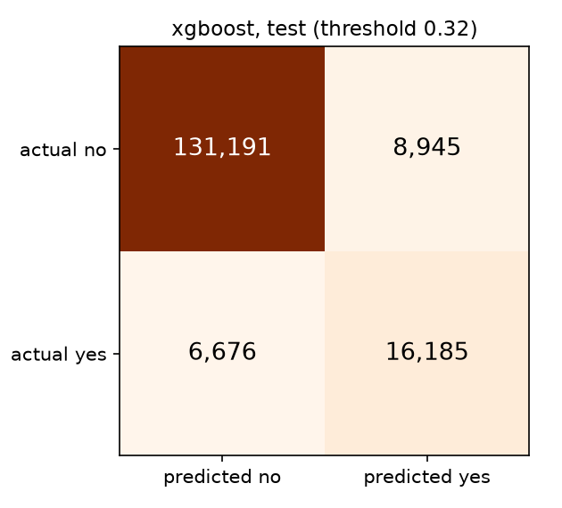
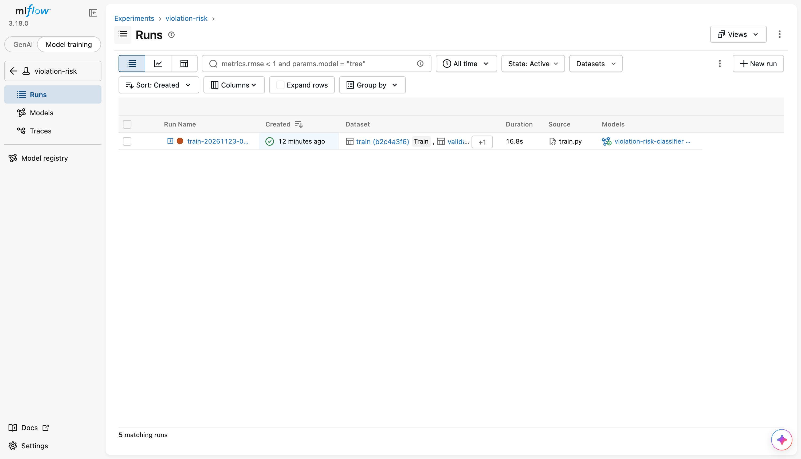
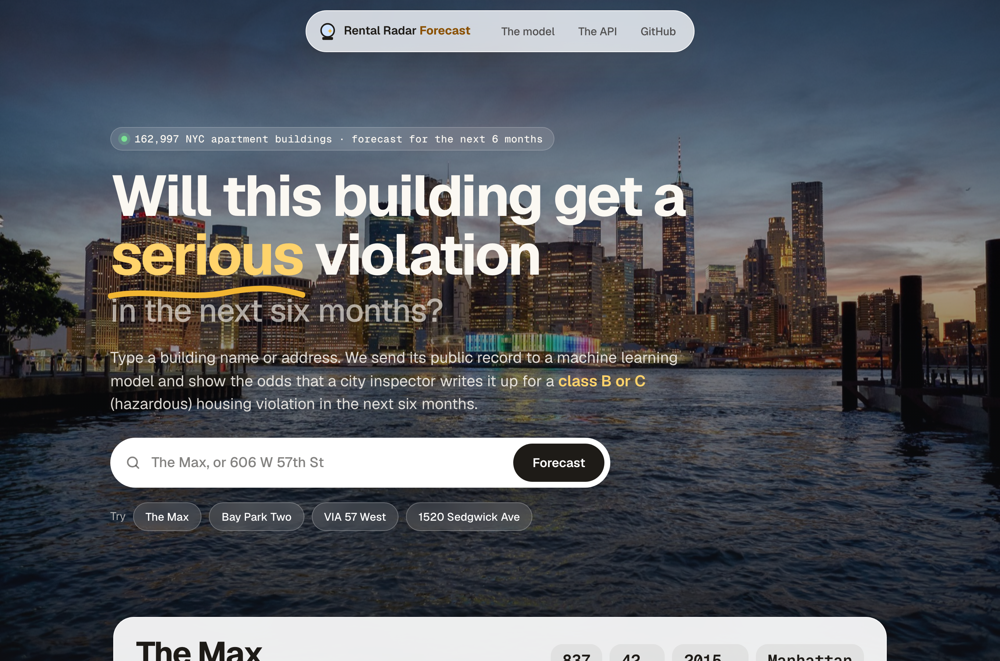
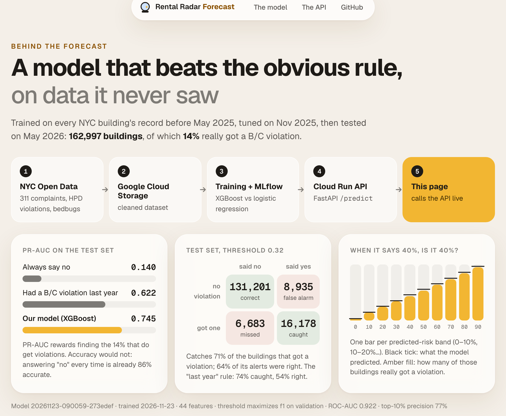

# Rental Radar Forecast

**Will this New York City apartment building get a serious housing violation in the next six months?**

An end-to-end ML system on public NYC Open Data. It cleans the raw data locally and uploads it to Google Cloud Storage. A training pipeline downloads it, builds features, splits the data by time, trains and evaluates two models, and tracks every run in MLflow. The selected model is served by a FastAPI app in Docker on Cloud Run. A web front end on Hugging Face Spaces calls that API.

Duke AIPI 510 · Module Project 3: Data/ML Engineering

| | Link |
|---|---|
| **Front end** (Hugging Face Spaces) | FRONTEND_URL |
| **API** (Cloud Run) | API_URL · interactive docs at API_URL/docs |
| **Predict endpoint** | `POST API_URL/predict` |


---

## Contents
1. [Overview and goals](#1-overview-and-goals)
2. [Dataset](#2-dataset)
3. [Model and evaluation](#3-model-and-evaluation)
4. [Cloud services](#4-cloud-services)
5. [Setup](#5-setup)
6. [Usage: train, build, test the API, deploy](#6-usage-train-build-test-the-api-deploy)
7. [Front end](#7-front-end)
8. [Repository structure](#8-repository-structure)
9. [Ethics and limitations](#9-ethics-and-limitations)

---

## 1. Overview and goals

Renters in NYC sign leases with little idea how a building is maintained. The city publishes every 311 complaint and every Housing Preservation and Development (HPD) violation, but raw records do not say what is likely to happen next. This project turns those records into one forecast a renter can read in seconds.

**Supervised task.** Binary classification with one row per building per cutoff date *T*:

| | Definition |
|---|---|
| **Target** `y` | 1 if the building receives **at least one class B (hazardous) or class C (immediately hazardous) HPD violation in the 6 months after *T***, otherwise 0 |
| **Features** | only events **before *T***: 311 complaints by topic, HPD violations by class, bedbug filings, and building attributes (44 features) |
| **Primary metric** | **PR-AUC** (average precision). Only 14% of buildings are positive, so accuracy is misleading: always answering "no" scores 86% accuracy. |
| **Also reported** | ROC-AUC; precision, recall, F1 and the full confusion matrix at a threshold chosen on validation; precision among the top 10% riskiest; calibration |

**Goals**
1. A reproducible pipeline from raw public data to a deployed model, with every parameter in `config.yaml`.
2. An honest evaluation: time-based split, a held-out test period, and comparison against simple baselines.
3. A forecast a renter can act on: the probability, the reasons behind it, and one question to ask at the viewing.

## 2. Dataset

All data is public, from [NYC Open Data](https://opendata.cityofnewyork.us/). The snapshot was downloaded on 2026-11-14 and covers events from 2024-01-01 to 2026-11-14.

| Dataset | ID | Used for |
|---|---|---|
| [Housing Maintenance Code Violations](https://data.cityofnewyork.us/d/wvxf-dwi5) | `wvxf-dwi5` | label (B/C violations after *T*) and violation features before *T*; 3.7M rows after cleaning |
| [311 Service Requests](https://data.cityofnewyork.us/d/erm2-nwe9) | `erm2-nwe9` | complaint counts by topic: noise, heat, mold or leaks, pests, repairs, sanitation; 4.7M rows, 3.3M matched to a building |
| [Bedbug Reporting](https://data.cityofnewyork.us/d/wz6d-d3jb) | `wz6d-d3jb` | infested and re-infested units in the past 24 months |
| [Buildings Subject to HPD Jurisdiction](https://data.cityofnewyork.us/d/kj4p-ruqc) | `kj4p-ruqc` | the building list (active, 3+ legal units): **162,997 buildings** |
| [PLUTO](https://data.cityofnewyork.us/d/64uk-42ks) | `64uk-42ks` | year built, buildings on the lot, coordinates |
| [Registrations](https://data.cityofnewyork.us/d/tesw-yqqr) and [Registration Contacts](https://data.cityofnewyork.us/d/feu5-w2e2) | `tesw-yqqr`, `feu5-w2e2` | whether a management company is registered (company names only) |
| [Affordable Housing Production by Building](https://data.cityofnewyork.us/d/hg8x-zxpr) | `hg8x-zxpr` | official building names, used for search only |

**Modeling table.** Each building gets a snapshot at three cutoffs, giving 488,991 labeled rows:

| Split | Cutoff *T* | Features from | Label window | Rows | Positive |
|---|---|---|---|---|---|
| train | 2025-05-01 | 2024-05-01 – 2025-04-30 | 2025-05-01 – 2025-10-31 | 162,997 | 13.3% |
| validation | 2025-11-01 | 2024-11-01 – 2025-10-31 | 2025-11-01 – 2026-04-30 | 162,997 | 14.3% |
| test | 2026-05-01 | 2025-05-01 – 2026-04-30 | 2026-05-01 – 2026-10-31 | 162,997 | 14.0% |
| live (served) | 2026-11-14 | 2025-11-14 – 2026-11-13 | the future | 162,997 | – |

**Cleaning** (`data_prep/clean.py`)
- Dates are parsed with `TRY_CAST`; rows with dates that cannot be parsed are dropped.
- Street names are normalized (`W 57TH ST` → `WEST 57 STREET`) so 311 addresses join to HPD buildings.
- Only active buildings with at least 3 legal units are kept.
- Violations are de-duplicated by ID, and repeated bedbug filings keep the latest one.
- Impossible values are treated as data-entry errors:
  - bedbug counts are capped at the building's unit count (one 4-unit building reported 414,754 infested units);
  - stories outside 1–200 and buildings-per-lot outside 1–500 become missing and are imputed later.

**Data checks** (`data_prep/make_dataset.py`) stop the build if any of these fail:
- a label window extends past the end of the data;
- a look-back window starts before the data does;
- a building has anything other than one row per cutoff;
- any label is NULL, or any count is negative.

`tests/test_data.py` places events the day before, on, and after a cutoff and checks that each lands on the right side.

## 3. Model and evaluation

**Preprocessing** (`src/features.py`, a scikit-learn transformer saved inside the model)
- Missing units, stories, year built, lot size and coordinates are filled with **training-set medians**. The medians are learned in `fit()` on the training rows only, so validation, test and API requests are filled with the same numbers.
- Derived features: building age, and borough as five 0/1 columns.
- Complaints and B/C violations per 10 units, so large buildings are not flagged for size alone.
- `log1p` on counts for the linear model.

**Models** (`src/train.py`, hyperparameters in `config.yaml`)

| Model | Setup |
|---|---|
| Baseline: always no | predicts 0 for every building |
| Baseline: B/C last year | predicts 1 if the building had any B/C violation in the past 12 months |
| Logistic regression | StandardScaler + L2 logistic regression (C = 1.0) |
| **XGBoost (selected)** | 600 trees max, depth 6, learning rate 0.05, subsample 0.8, early stopping on validation PR-AUC |

The decision threshold maximizes F1 on **validation**. The served model is the one with the best **validation** PR-AUC. The test set is used only to report results.

**Test results** (cutoff 2026-05-01, n = 162,997, 22,861 positives; from [`reports/metrics.json`](reports/metrics.json))

| Model | PR-AUC | ROC-AUC | Precision | Recall | F1 | Top-10% precision | Accuracy |
|---|---|---|---|---|---|---|---|
| Always no | 0.140 | 0.500 | 0.000 | 0.000 | 0.000 | 0.140 | 0.860 |
| B/C last year (rule) | 0.622 | 0.836 | 0.536 | 0.737 | 0.620 | 0.716 | 0.874 |
| Logistic regression | 0.728 | 0.913 | 0.640 | 0.692 | 0.665 | 0.763 | 0.902 |
| **XGBoost** | **0.744** | **0.922** | **0.644** | 0.708 | **0.675** | **0.773** | **0.904** |

Against the "last year" rule, XGBoost finds almost the same number of real cases: 16,185 against 16,850. It raises **5,663 fewer false alarms**: 8,945 against 14,608.

| Confusion matrix, XGBoost (threshold 0.32) | Precision-recall curves |
|---|---|
|  |  |

**Calibration.** Within each predicted-risk band on the test set, the share of buildings that really got a violation matches the prediction:

| Predicted band | Buildings | Mean predicted | Observed rate |
|---|---|---|---|
| 0–10% | 118,174 | 2.9% | 2.5% |
| 20–30% | 6,331 | 24.7% | 24.8% |
| 50–60% | 3,446 | 54.9% | 53.2% |
| 90–100% | 4,602 | 95.8% | 95.6% |

The front end can therefore say: "Of the 6,331 buildings scored 20–30%, 25% really got a B/C violation."

**Explanations.** For XGBoost the API returns per-building SHAP contributions (`pred_contribs`) and lists the strongest drivers with their values. Coordinates and borough are reported together as "location". By total gain, the most important features are B/C violations per 10 units, class B violations in the past year, 311 complaints in the past year, and class C violations (see [`reports/figures/importance_xgboost.png`](reports/figures/importance_xgboost.png)).

### Experiment tracking (MLflow)

Every `python -m src.train` creates one parent run with four nested runs: two baselines and two models. The selected model is logged and registered from the parent run. MLflow uses a SQLite backend in `mlruns/mlflow.db`, with artifacts in `mlruns/`. It records:

| What | Where |
|---|---|
| Parameters | all `features`, `target`, `split` and `evaluation` settings, and each model's hyperparameters |
| Metrics | validation and test PR-AUC, ROC-AUC, precision, recall, F1, accuracy, confusion counts, best XGBoost iteration |
| Datasets | train, validation and test logged as MLflow inputs, with the GCS source URI and the SHA-256 of the data |
| Artifacts | confusion matrices, PR curves, feature importance, `metrics.json`, the serving bundle, and each model logged with a signature and input example |
| Model registry | the selected model registered as `violation-risk-classifier` |

```bash
mlflow ui --backend-store-uri sqlite:///mlruns/mlflow.db   # http://localhost:5000
```


## 4. Cloud services

| Service | Role |
|---|---|
| **Google Cloud Storage** | Holds the cleaned, processed dataset under `gs://<bucket>/v1/`: `snapshots.parquet`, `live.parquet`, `buildings.parquet` and `manifest.json` with SHA-256 hashes. The training pipeline downloads from here and verifies every file. |
| **Cloud Build + Artifact Registry** | Build the Docker image from this repo (`gcloud run deploy --source .`). |
| **Cloud Run** | Runs the API container: public (no auth), 2 GiB memory, scales to zero, at most 3 instances. |
| **Hugging Face Spaces** (static) | Hosts the front end, which calls the Cloud Run API from the browser (CORS enabled). |

```
 NYC Open Data ──download──▶ data/raw ──clean──▶ data/clean ──snapshots + checks──▶ data/processed
   (Socrata API)            data_prep/download.py  data_prep/clean.py  data_prep/make_dataset.py
                                                                                 │ data_prep/upload.py
                                                                                 ▼
                                                                  Google Cloud Storage  gs://<bucket>/v1/
                                                                                 │ src/ingest.py (SHA-256 checked)
                                                                                 ▼
  config.yaml ──▶  src/features.py → src/split.py → src/train.py → src/evaluate.py ──▶ MLflow (runs, metrics, registry)
                                                                                 │ artifacts/model/
                                                                                 ▼
                                          Docker image ──Cloud Build──▶ Cloud Run: FastAPI /predict
                                                                                 ▲ HTTPS + JSON
                                                         Hugging Face Space: front end (search → forecast)
```

## 5. Setup

Requirements: Python 3.12 and Docker. Cloud steps also need the [gcloud CLI](https://cloud.google.com/sdk/docs/install) and a GCP project with billing enabled.

```bash
git clone https://github.com/canyangxu/rental-radar-ml.git && cd rental-radar-ml
python3.12 -m venv .venv && source .venv/bin/activate
pip install -r requirements.txt          # pinned versions
pytest -q                                 # 29 tests, runs offline on synthetic data
```

Every parameter is in [`config.yaml`](config.yaml): data sources and dates, feature windows, target, split cutoffs, model hyperparameters, evaluation, MLflow and serving. Three environment variables override per-machine values:

| Variable | Overrides | Example |
|---|---|---|
| `GCS_BUCKET` | `data.gcs.bucket` | `rental-radar-ml-data` |
| `MLFLOW_TRACKING_URI` | `mlflow.tracking_uri` | `sqlite:///mlruns/mlflow.db` |
| `MODEL_DIR` | `serving.model_dir` | `artifacts/model` |

## 6. Usage: train, build, test the API, deploy

### 6.1 Prepare the data locally and upload it to GCS (once)
```bash
python -m data_prep.download        # NYC Open Data → data/raw/   (about 500 MB, resumable)
python -m data_prep.clean           # → data/clean/*.parquet
python -m data_prep.make_dataset    # → data/processed/ (snapshots, live, search index, manifest + checks)

gcloud auth login && gcloud auth application-default login
GCP_PROJECT=<project> GCS_BUCKET=<bucket> scripts/setup_gcs.sh   # creates the bucket, runs data_prep/upload.py
```

### 6.2 Train (downloads from GCS)
```bash
GCS_BUCKET=<bucket> python -m src.train
```
This step:
1. downloads and verifies the dataset from GCS;
2. trains both baselines and both models;
3. logs everything to MLflow;
4. writes the serving bundle to `artifacts/model/` (`model.joblib`, `metadata.json`, `live.parquet`, `buildings.parquet`);
5. writes `reports/metrics.json` and the figures.

`DATA_SOURCE=local` reads `data/processed/` instead of GCS, for offline runs only.

### 6.3 Build and run the Docker image locally
One image, two entry points: `serve` (the default) and `train`, plus `test`.
```bash
docker build -t rental-radar-ml .
docker run --rm -p 8080:8080 rental-radar-ml                 # serve: FastAPI on :8080
docker run --rm rental-radar-ml test                         # run the test suite in the container
docker run --rm -e GCS_BUCKET=<bucket> -e GOOGLE_CLOUD_PROJECT=<project> \
  -v ~/.config/gcloud/application_default_credentials.json:/creds.json:ro -e GOOGLE_APPLICATION_CREDENTIALS=/creds.json \
  -v "$PWD/artifacts:/app/artifacts" -v "$PWD/mlruns:/app/mlruns" -v "$PWD/reports:/app/reports" \
  rental-radar-ml train                                      # train: full pipeline inside the container
```

### 6.4 Test the API locally with curl
```bash
uvicorn api.main:app --port 8080          # or the docker run above
scripts/smoke_test.sh http://localhost:8080
```
`smoke_test.sh` calls every endpoint and fails on any unexpected status. A single prediction:
```bash
curl -X POST http://localhost:8080/predict -H "Content-Type: application/json" \
  -d '{"borough":"MANHATTAN","units":837,"stories":42,"year_built":2015,"has_mgmt":true,
       "c12_all":34,"c12_noise":13,"c12_mold":6,"c12_pests":5,"c3_all":5,"v12_a":1,"v12_b":1,"bb24_infested":1}'
```
```json
{"probability":0.2694,"label":0,"risk_level":"medium","percentile":0.825,"threshold":0.32,"base_rate":0.1464,
 "backtest_band":{"low":0.2,"high":0.3,"n":6331,"mean_predicted":0.2465,"observed_rate":0.2481},
 "drivers":[{"feature":"c12_all","label":"311 complaints, past year","value":34.0,"effect":"raises","contribution":0.62}, "..."],
 "model_version":"20261123-084352-38f1eb0"}
```

| Endpoint | Description |
|---|---|
| `POST /predict` | JSON features of one building → probability, 0/1 label, risk level, NYC percentile, backtest band, drivers |
| `POST /predict/batch` | `{"instances": [...]}`, up to 500 buildings |
| `GET /buildings/search?q=` | find a building by name or address (`625 W 57th St`, `The Max`) |
| `GET /buildings/{bid}` | the building's latest features: the exact JSON the front end sends to `/predict` |
| `GET /model` | version, threshold, test metrics, baselines, calibration |
| `GET /health`, `GET /docs` | health check; OpenAPI docs |

Every field is optional: a missing count means 0, and a missing attribute gets the training median. Invalid input returns **422**: negative counts, unknown boroughs, coordinates outside NYC, or unknown field names.

### 6.5 Deploy
```bash
GCP_PROJECT=<project> scripts/deploy_cloudrun.sh
```
This builds with Cloud Build, deploys a public Cloud Run service, then runs `smoke_test.sh` against the live URL.
```bash
API_URL=<cloud run url> HF_SPACE=<hf-user>/rental-radar-forecast scripts/deploy_frontend_hf.sh
```
This publishes the front end with `API_URL` set.

Verify the deployed endpoint with a plain HTTP request:
```bash
curl -X POST API_URL/predict -H "Content-Type: application/json" -d '{"borough":"BRONX","units":40,"v12_b":6,"v12_c":3,"c12_all":25}'
```

## 7. Front end

A static page (HTML, CSS and JavaScript, no build step) in [`frontend/`](frontend), in the same visual style as the Rental Radar app. It sends every request to the deployed API:

1. **Search** a building by name or address, or try an example. `GET /buildings/search`
2. **Forecast card.** `GET /buildings/{id}` returns the features, then `POST /predict`:
   - the probability, with a count-up animation;
   - a gauge with the NYC average marked;
   - a "Top 3% riskiest in NYC" sticker;
   - the reasons behind the score;
   - one question to ask at the viewing.
3. **Behind the forecast.** `GET /model` supplies the pipeline steps, PR-AUC against the baselines, the confusion matrix and calibration.
4. **The live request.** The exact JSON sent to `/predict`, the response, the latency and a copy-as-curl button.

The API base URL is set in `frontend/config.js` (`?api=` overrides it). Run it locally:
```bash
python -m http.server 5173 --directory frontend     # with the API on :8080
```

| Search | Model section | Live request |
|---|---|---|
|  |  |  |

## 8. Repository structure

```
config.yaml              every parameter of the pipeline
requirements.txt         pinned dependencies (Python 3.12)
Dockerfile               one image: serve | train | test
data_prep/               LOCAL, run once: download → clean → make_dataset (+ checks) → upload to GCS
src/
  config.py              load and validate config.yaml (+ env overrides)
  ingest.py              download the dataset from GCS, verify SHA-256
  features.py            preprocessing and feature engineering (fitted on train only)
  split.py               time-based train / validation / test split
  train.py               baselines + models, threshold and model selection on validation, MLflow
  evaluate.py            metrics, calibration, figures
  predict.py             load the model bundle, predict, explain
api/                     FastAPI app (main.py) and request/response schemas (schemas.py)
frontend/                static web front end (Hugging Face Space)
scripts/                 setup_gcs.sh, deploy_cloudrun.sh, deploy_frontend_hf.sh, smoke_test.sh, entrypoint.sh
tests/                   29 tests: config, leakage at the cutoff, GCS integrity, features, training end to end, API
reports/                 test metrics (metrics.json) and figures from the latest run
docs/img/                screenshots
```

Development history: each part landed through its own branch and pull request (skeleton → data → model → API → Docker/Cloud Run → front end → docs).

## 9. Ethics and limitations

**What the label really measures.** A violation exists only if an inspector visited, and inspections mostly follow tenant complaints. The model therefore predicts *recorded* violations, not true building condition.
- Buildings whose tenants complain less, for example because of language barriers, fear of retaliation or immigration status, can look safer than they are.
- Complaint-heavy buildings can look worse.

The page says plainly that this is "a forecast, not an inspection".

**Fairness and harm.**
- **Neighborhood signal.** Location features carry neighborhood patterns, which in NYC correlate with income and race. Used against tenants, for example to steer applicants or set rents, the score could reinforce existing inequity.
- **Intended use.** The model is meant to help renters ask better questions. It is not meant for landlords, insurers or lenders to screen buildings or people, and should not be used that way.
- **Ownership data.** The model uses no personal data about tenants. Ownership data is limited to whether a management company is registered, from company names only; names of individual people are never downloaded.

**Size bias.** Large buildings get more complaints simply because more people live there. Per-unit rates reduce this, but the number of units is still a strong feature. A small building with one serious violation can score lower than it should.

**Errors have costs.**
- At the chosen threshold the model misses 29% of the buildings that did get a B/C violation: 6,676 false negatives.
- 36% of its alerts are false alarms: 8,945.

The page shows the probability and the calibration band instead of a yes/no verdict, and pairs every forecast with a concrete question to verify in person.

**Time and drift.**
- The data is frozen on 2026-11-14.
- The test label window ends on 2026-10-31, two weeks before that. Violations from late October that HPD had not yet posted count as negatives, so test results may be slightly pessimistic.
- Test results come from one six-month window.
- HPD enforcement priorities, inspection staffing and seasons (heat violations peak in winter) shift the base rate.

The model should be retrained on new snapshots and re-checked on a later period before anyone relies on it.

**Other limitations.**
- 311 complaints are matched to buildings by normalized address, and about 30% do not match and are excluded.
- Building names come from HPD data plus a short curated list, so some marketed names are not searchable; the street address always is.
- The model is correlational: it does not explain *why* a building gets violations.
